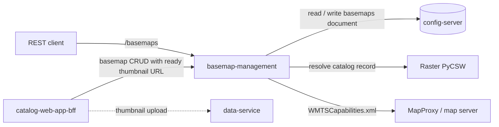

# basemap-management

REST service that manages **Basemaps** for the MapColonies ecosystem. A Basemap is a named, ordered composition of map layers, with a thumbnail and two "default role" flags (`isCurrent`, `isForPreview`). Clients such as the Main App consume it to decide which layers to render.

The service owns Basemap *configuration* only. It stores no tiles and no raster data.

- [Architecture](#architecture)
- [Getting started](#getting-started)
- [Configuration](#configuration)
- [API](#api)
- [Data models](#data-models)
- [Testing](#testing)
- [Build and deployment](#build-and-deployment)
- [Development notes](#development-notes)

## Architecture



Three concerns are kept separate:

1. **Configuration storage.** The whole Basemap list is one JSON document (`{ "basemaps": [...] }`) held in config-server under `CONFIG_BASEMAPS_NAME`. Catalog layers are stored only as *references* (`domain` + `uniqueness`), never as resolved data.
2. **Catalog resource resolution.** On every read, `CatalogResourceResolver` turns each stored catalog reference into a resolved one: it asks the Raster Catalog for the record, finds the record's `WMTS` link, and matches the link name against the layers in the map server's WMTS capabilities. If any step fails, the layer's source is returned with `status: 'UNRESOLVED'` (`layer` and `capabilities` both `null`). It is never dropped and never fails the request.
3. **External resources.** `EXTERNAL` layers are stored and returned as-is (`protocol`, `name`, `url`, plus any extra keys). They are not fetched or validated beyond those three fields.

| Integration | Client | Status |
| --- | --- | --- |
| config-server | `HttpConfigServerClient` | Implemented. `GET/POST {CONFIG_MANAGEMENT_URL}/api/config`. |
| Map server (Raster MapProxy) | `HttpMapServerCapabilitiesClient` | Implemented. Fetches `{MAP_SERVER_URL}/wmts/1.0.0/WMTSCapabilities.xml` once per request. |
| Raster Catalog | `HttpRasterCatalogClient` | Implemented. Queries Raster PyCSW via `@map-colonies/csw-client`, filtering on `mc:productId` + `mc:productType`, mapping the result with `@map-colonies/mc-model-types`' `PycswLayerCatalogRecord.getPyCSWMappings()`. If `RASTER_CATALOG_URL` is empty or unreachable, the catalog layer's source comes back with `status: 'UNRESOLVED'`. |
| Thumbnail storage | - | **Not this service's job.** Thumbnail images are uploaded by `catalog-web-app-bff` to data-service; this service only stores and returns the ready `thumbnail.url`. The one exception is `/basemaps/import/validate`, which still extracts the thumbnail binary from the ZIP and returns it base64-encoded. |

Source layout:

```
src/
  basemaps/
    controllers/   HTTP handlers (CRUD, import/export)
    routes/        Express router mounted at /basemaps
    models/        manager, catalog resolver, validation, default-role policy, types
    packaging/     export/import ZIP reader and writer
    thumbnails/    PNG/WebP header sniffing (used by the import ZIP reader)
  clients/         configServer, mapServer, rasterCatalog
  common/          config, env, errors, tracing, multipart helper
openapi3.yaml      API contract (also used for request validation)
config/            node-config defaults
helm/              Helm chart
tests/             unit and integration tests
```

## Getting started

### Prerequisites

- Node.js 24 (see [.nvmrc](.nvmrc))
- npm
- A reachable config-server. It is required for every `/basemaps` call, because all state lives there.
- Optional: a MapProxy URL, to get resolved catalog layers (see the stub note above).
- Optional: Docker and Helm, for container and cluster deployment.

### Install

```bash
npm install
```

`npm install` also runs the `prepare` script, which installs the Husky git hooks (commitlint, pre-commit).

### Run locally

`start:dev` builds the project, enables `@map-colonies/config` offline mode and source maps, and starts the server on port 8080:

```bash
npm run start:dev
```

Service settings (MapProxy, Raster Catalog, config-server, access token) are read from `config/default.json`, so edit them there - or, for anything you don't want tracked (e.g. a MapProxy token), in a git-ignored `config/local-development.json` (see [Configuration](#configuration)). Environment variables still override both. `CONFIG_MANAGEMENT_URL` defaults to `http://localhost:8080`, which is also this service's own port, so point it elsewhere or change `SERVER_PORT`.

Then open the Swagger UI at <http://localhost:8080/docs/api/> (raw spec: `/docs/api.json`).

`npm start` does the same without offline mode. It needs a real `@map-colonies/config` server (`CONFIG_SERVER_URL`, `CONFIG_NAME`, `CONFIG_VERSION`) for the boilerplate settings.

### Scripts

| Script | Purpose |
| --- | --- |
| `npm run start:dev` | Build and run in offline-config mode with source maps |
| `npm start` | Build and run |
| `npm run build` | Clean, regenerate OpenAPI types, compile to `dist/`, copy assets |
| `npm run generate:openapi-types` | Regenerate `src/openapi.d.ts` from `openapi3.yaml`. Run after any OpenAPI change. |
| `npm run lint` / `lint:fix` | ESLint (runs Prettier check/fix first) |
| `npm run format` / `format:fix` | Prettier check / write |
| `npm run lint:openapi` | Lint `openapi3.yaml` with Redocly |
| `npm test`, `test:unit`, `test:integration`, `test:watch`, `test:ui` | Vitest, see [Testing](#testing) |
| `npm run helm-update` / `helm-install` / `helm-uninstall` | Helm helpers, see [Build and deployment](#build-and-deployment) |

Commits follow Conventional Commits (enforced by commitlint). Releases are managed by release-please.

## Configuration

Settings come from two places.

### 1. Service settings (`config/*.json` + environment overrides)

Read in [src/common/env.ts](src/common/env.ts) from the `@map-colonies/config` instance and validated with zod; invalid values fail startup with the offending paths (values, including the token, are never echoed). `@map-colonies/config` loads the local files through node-config, so the layering is the same as in `catalog-web-app-bff`:

1. `config/default.json` - local-development defaults (integration MapProxy / PyCSW URLs, no token).
2. `config/{NODE_ENV}.json` - `production.json` (the Docker image sets `NODE_ENV=production`) and `test.json` reset the MapProxy / PyCSW URLs to `''`, so a deployment that leaves them unset behaves as before (catalog layers `UNRESOLVED`) instead of silently using integration services.
3. `config/local.json` / `config/local-{NODE_ENV}.json` - **git-ignored** (and excluded from the Docker build context) personal overrides; put a MapProxy token here, e.g. `config/local-development.json` for `npm run start:dev`.
4. Environment variables, mapped in `config/custom-environment-variables.json` (names below; unchanged for Helm, plus the BFF's `ACCESS_TOKEN_*`). An **empty** variable does not override (node-config semantics).

`CONFIG_OFFLINE_MODE` only decides whether the boilerplate settings are also fetched from a remote config server; the local files and env overrides above apply in both modes.

| Config path | Variable | Default (`default.json`) | Description |
| --- | --- | --- | --- |
| `configServer.url` | `CONFIG_MANAGEMENT_URL` | `http://localhost:8080` | config-server **origin only**, without `/api/config` (the service appends it). |
| `configServer.configName` | `CONFIG_BASEMAPS_NAME` | `basemaps` | `configName` of the Basemaps document in config-server. |
| `configServer.schemaId` | `CONFIG_BASEMAPS_SCHEMA_ID` | `https://mapcolonies.com/basemaps/v1` | config-server `schemaId` for that document. Not yet registered in config-server's schemas. |
| `mapServer.url` | `MAP_SERVER_URL` | integration MapProxy (`''` in production/test) | Raster MapProxy base URL. `/wmts/1.0.0/WMTSCapabilities.xml` is appended unless already present; an existing query string is kept. If empty or unreachable, catalog layers come back `UNRESOLVED`. |
| `mapServer.exposureType` | - | `ROUTE` | `ROUTE` or `SERVICE`, as the BFF's `mapServices.raster.exposureType`. The token is only sent to a `ROUTE`. |
| `rasterCatalog.exposureType` | - | `ROUTE` | `ROUTE` or `SERVICE`, as the BFF's `csw.raster.exposureType`. The token is only sent to a `ROUTE`. |
| `accessToken.attributeName` | `ACCESS_TOKEN_ATTRIBUTE_NAME` | `token` | Same as the BFF. |
| `accessToken.injectionType` | `ACCESS_TOKEN_INJECTION_TYPE` | `queryParam` | `queryParam` or `header` (case-insensitive), same as the BFF. As in the BFF, PyCSW requests support both; WMTS capabilities requests support only `queryParam` (`header` logs a warning and sends no token to MapProxy). |
| `accessToken.tokenValue` | `ACCESS_TOKEN_TOKEN_VALUE` | `''` | MapProxy token. Empty = unauthenticated requests. Never commit it; it is redacted from MapProxy and PyCSW client logs and errors. |
| `rasterCatalog.url` | `RASTER_CATALOG_URL` | integration PyCSW (`''` in production/test) | Raster PyCSW base URL. If empty or unreachable, catalog layers come back `UNRESOLVED`. |
| `uploadLimits.importPackageMaxSizeBytes` | `IMPORT_PACKAGE_MAX_SIZE_BYTES` | `10485760` (10 MiB) | Max import package upload size. |
| - | `BASEMAP_MOCK_DATA` | unset (off) | **Raw environment variable only (not a config file key). Development/demo only. Never enable in production.** `true` turns on [mock mode](#mock-mode). Only the exact values `true` and `false` are accepted; any other value fails startup. Deliberately not exposed in the Helm chart. Unrelated to `CONFIG_OFFLINE_MODE`. |

Example git-ignored `config/local-development.json`:

```json
{
  "rasterCatalog": { "url": "https://<pycsw-route>/api/raster/v1", "exposureType": "ROUTE" },
  "mapServer": { "url": "https://<mapproxy-route>/api/raster/v1", "exposureType": "ROUTE" },
  "accessToken": { "attributeName": "token", "injectionType": "queryParam", "tokenValue": "<YOUR_MAPPROXY_TOKEN>" }
}
```

The multipart parser limit is `IMPORT_PACKAGE_MAX_SIZE_BYTES` (import is the only multipart route). The import ZIP reader separately caps the archive at 10 entries and 10 MiB uncompressed.

### 2. Boilerplate settings (`@map-colonies/config`)

Validated against `commonBoilerplateV3` from `@map-colonies/schemas`. Defaults are in [config/default.json](config/default.json) (`config/production.json` and `config/test.json` are empty). Common environment overrides:

| Variable | Default | Description |
| --- | --- | --- |
| `SERVER_PORT` | `8080` | HTTP port. The Dockerfile also sets `8080`. |
| `LOG_LEVEL` | `info` | Log level. |
| `LOG_PRETTY_PRINT_ENABLED` | `false` | Pretty logs for local reading. |
| `OPENTELEMETRY_LOGGING_ENABLED` / `OTLP_LOGGER_ENDPOINT_URL` | `false` / unset | OpenTelemetry log export. |
| `TELEMETRY_TRACING_ENABLED` / `TELEMETRY_TRACING_URL` | `false` / unset | Tracing export. |
| `CONFIG_OFFLINE_MODE` | `false` | Use local `config/` files only (set by `start:dev`). |
| `CONFIG_SERVER_URL`, `CONFIG_NAME`, `CONFIG_VERSION` | n/a | Where the `@map-colonies/config` package fetches its own settings in online mode. Distinct from the Basemaps document above. |

Request body limit (`server.request.payload.limit`, `1mb`) and response compression are set in `config/default.json`. The Helm chart maps `env.requestPayloadLimit` and `env.responseCompressionEnabled` to `REQUEST_PAYLOAD_LIMIT` and `RESPONSE_COMPRESSION_ENABLED`.

> Note: `@map-colonies/config` and the service settings are intentionally separate. The shared boilerplate schema has no extension point for domain settings, so those are read straight from the environment.

## API

Full contract: [openapi3.yaml](openapi3.yaml), served at `/docs/api/`. All routes are mounted under `/basemaps`. There is no authentication or authorization in this service (`security: - {}`); protect it at the gateway or network level.

| Method | Path | Description | Success |
| --- | --- | --- | --- |
| `GET` | `/basemaps` | List all Basemaps (catalog layers resolved) | `200` |
| `POST` | `/basemaps` | Create a Basemap | `201` |
| `GET` | `/basemaps/{basemapId}` | Get one Basemap | `200` |
| `PUT` | `/basemaps/{basemapId}` | Fully replace a Basemap | `200` |
| `DELETE` | `/basemaps/{basemapId}` | Delete a Basemap | `204` |
| `GET` | `/basemaps/{basemapId}/export` | Download a portable ZIP (`basemap.json` + thumbnail) | `200` |
| `POST` | `/basemaps/import/validate` | Validate an export ZIP (`multipart/form-data`, field `package`). Persists nothing. | `200` |

Errors are JSON `{ "message": "..." }`: `400` validation, `404` unknown id, `502` config-server or thumbnail download failure (`UpstreamServiceError`). Request shape is validated by `express-openapi-validator` before any handler runs.

Liveness: `GET /liveness` (served at the root, outside `/basemaps`).

### Create flow

1. Get a ready thumbnail URL. This service does not accept image uploads: `catalog-web-app-bff` validates the image (128x128 PNG/WebP), uploads it to data-service and passes the resulting URL here.

2. Create the Basemap with that reference as `thumbnail`:

   ```bash
   curl -X POST http://localhost:8080/basemaps \
     -H 'content-type: application/json' \
     -d '{
       "name": "Default",
       "thumbnail": { "url": "https://data-service/pvc/files/basemaps/thumbnails/<uuid>.png", "width": 128, "height": 128 },
       "isCurrent": true,
       "isForPreview": false,
       "layers": [
         {
           "id": "orthophoto",
           "order": 0,
           "opacity": 1,
           "source": {
             "type": "CATALOG_RESOURCE",
             "domain": "RASTER",
             "uniqueness": { "productId": "MY_PRODUCT", "productType": "Orthophoto" }
           }
         },
         {
           "id": "osm",
           "order": 1,
           "opacity": 0.5,
           "source": {
             "type": "EXTERNAL",
             "details": { "protocol": "XYZ", "name": "osm", "url": "https://tile.example.com/{z}/{x}/{y}.png" }
           }
         }
       ]
     }'
   ```

### Write rules

- `name` non-empty; `thumbnail.url` non-empty; `opacity` between 0 and 1; `order` integer >= 0.
- Layer `id` and `order` must each be unique within a Basemap.
- Catalog layers need a non-empty `uniqueness.productId` and a known `productType` (`Orthophoto`, `OrthophotoHistory`, `OrthophotoBest`, `RasterMap`, `RasterMapBest`, `RasterAid`, `RasterAidBest`, `RasterVector`, `RasterVectorBest`).
- External layers need `protocol` (`XYZ`, `WMTS`, `WMS`, `OSM`), `name` and `url`.
- **Default roles:** at most one Basemap has `isCurrent=true` and at most one has `isForPreview=true`. Setting a flag to `true` on create or update clears it from the previous owner in the same write. The two flags are independent.
- `PUT` replaces the whole Basemap. `id` is server-assigned (a UUID on create); the body has no `id` field.
- Writes accept only the input shape (`CATALOG_RESOURCE` with `uniqueness`, or `EXTERNAL` with `details`) - the output-only `status`, `layer`, and `capabilities` fields are not part of the write contract.

### Layer source types

Input (accepted by `POST`/`PUT`, and what is persisted/exported) and output (returned by every read and write response, and the import review) are different types.

| Type | Direction | Shape | Meaning |
| --- | --- | --- | --- |
| `CATALOG_RESOURCE` | input | `domain`, `uniqueness` | Reference to a catalog product. Environment independent. |
| `EXTERNAL` | input and output | `details` | Externally served layer, returned unchanged. |
|

A catalog layer is resolved only when all of these hold:

1. The Raster Catalog returns a record for `uniqueness` (a real PyCSW lookup via `HttpRasterCatalogClient`; `null` if `RASTER_CATALOG_URL` is empty or unreachable).
2. The record has a `WMTS` link with a `name`.
3. The map server's WMTS capabilities contain a layer whose `ows:Identifier` equals that link name.

`capabilities` follows `CapabilityModelType`: `id`, `style[]`, `format[]`, `tileMatrixSet[]` (`tileMatrixSetID`, `tileMatrixLabels`), `url[]` (`format`, `resourceType`, `template`). Example resolved source (abridged):

```json
{
  "type": "CATALOG_RESOURCE",
  "domain": "RASTER",
  "uniqueness": { "productId": "MY_PRODUCT", "productType": "Orthophoto" },
  "status": "RESOLVED",
  "layer": { "id": "<record-id>", "productId": "MY_PRODUCT", "productType": "Orthophoto", "links": [{ "protocol": "WMTS", "name": "my-layer" }] },
  "capabilities": {
    "id": "my-layer",
    "format": ["image/png"],
    "tileMatrixSet": [{ "tileMatrixSetID": "WorldCRS84", "tileMatrixLabels": ["0", "1"] }],
    "url": [{ "format": "image/png", "resourceType": "tile", "template": "https://.../{TileMatrix}/{TileCol}/{TileRow}.png" }]
  }
}
```

### Export and import

`GET /basemaps/{id}/export` returns a ZIP with `basemap.json` (name, flags, thumbnail file name and size, layers as stored input) and the thumbnail binary. The service downloads the thumbnail from its stored URL, so export fails with `502` if that URL is not retrievable (e.g. an unreachable data-service URL).

`POST /basemaps/import/validate` reads such a ZIP and returns a review: each layer resolved like a normal read with `status` `RESOLVED` or `UNRESOLVED`, the thumbnail as base64, and `currentRoleConflict` / `previewRoleConflict` naming the Basemap that currently owns a role the package wants. The review is a draft; to import, the client posts the Basemap through the normal create endpoint. A malformed ZIP, unsafe entry names, a missing or non-128x128 thumbnail, or invalid `basemap.json` return `400`.

## Data models

Types live in [src/basemaps/models/types.ts](src/basemaps/models/types.ts) and [catalogTypes.ts](src/basemaps/models/catalogTypes.ts).

```ts
interface Basemap {                     // API output
  id: string; name: string;
  thumbnail: { url: string; width: 128; height: 128 };
  isCurrent: boolean; isForPreview: boolean;
  layers: BasemapLayerOutput[];
}
interface BasemapLayerBase {
  id: string; order: number; opacity: number;   // opacity 0..1
  shouldBeUsedInModelDraping?: boolean;
}
```

- **`domain`**: catalog domain of a catalog source. The API accepts only `RASTER` (the enum also lists `3D`, `DEM`, `VECTOR`, but they are not supported by the API schema or resolver).
- **`uniqueness`**: identity of a catalog product, `{ productId, productType }`. It is the only persisted identity of a catalog layer, so Basemaps stay portable across environments (no environment-specific record ids).
- **Source types**: see [Layer source types](#layer-source-types).

**Persisted vs. returned.** What is stored in config-server (`PersistedBasemap`) is the input shape: catalog layers as `CATALOG_RESOURCE` references. Responses are built on every request by resolving those references (`Basemap`). Resolved data is never written back, so catalog or MapProxy changes show up without touching stored Basemaps.

```jsonc
// config-server document for CONFIG_BASEMAPS_NAME
{ "basemaps": [ { "id": "<uuid>", "name": "...", "thumbnail": {...}, "isCurrent": true, "isForPreview": false, "layers": [ /* input-shaped layers */ ] } ] }
```

### Persistence and concurrency

Each write reads the latest document, applies the change, checks the role invariant, and POSTs the next version (`previous + 1`, or `1` for a new document). A `404` from config-server on read is treated as an empty list. Writes within one process are serialized by an in-memory queue. There is no cross-replica lock: concurrent writes from different replicas rely on config-server rejecting a stale version (a non-2xx reply becomes a `502`; this behaviour of config-server is not verified here). Treat the Helm default of one replica as the safe setting.

## Testing

Tests use [Vitest](https://vitest.dev/) with `supertest` and `jest-openapi` (responses are checked against `openapi3.yaml`). They need no external services: config-server, MapProxy and catalog are replaced by test doubles.

```bash
npm test                  # unit + integration, with coverage (80% thresholds)
npm run test:unit         # tests/unit, no coverage
npm run test:integration  # tests/integration, no coverage
npm run test:watch        # watch mode
npm run test:ui           # Vitest UI
```

Coverage reports (text, html, json) are written to `coverage/`.

## Build and deployment

### Docker

Multi-stage [Dockerfile](Dockerfile): builds on `node:24`, runs on `node:24.10.0-alpine3.22` as the non-root `node` user with `dumb-init`, `NODE_ENV=production`, `SERVER_PORT=8080`.

```bash
docker build -t basemap-management .
docker run --rm -p 8080:8080 \
  -e CONFIG_MANAGEMENT_URL=http://config-server \
  -e MAP_SERVER_URL=http://mapproxy \
  -e CONFIG_OFFLINE_MODE=true \
  basemap-management
```

Drop `CONFIG_OFFLINE_MODE` when a `@map-colonies/config` server is available (`CONFIG_SERVER_URL`, etc.).

### Helm

Chart in [helm/](helm/) (depends on `helm-common` from the MapColonies OCI registry). Deployment settings are in [helm/values.yaml](helm/values.yaml) and [helm/global.yaml](helm/global.yaml).

```bash
npm run helm-update    # helm dependency update helm
npm run helm-install   # helm install with global.yaml + values.yaml
npm run helm-uninstall
```

| Value | Maps to | Notes |
| --- | --- | --- |
| `global.configManagment.url` | `CONFIG_MANAGEMENT_URL` | Origin only, no `/api/config`. The key is spelled `configManagment` in the chart. |
| `configManagement.{name,version,offlineMode,serverUrl}` | `CONFIG_NAME`, `CONFIG_VERSION`, `CONFIG_OFFLINE_MODE`, `CONFIG_SERVER_URL` | `@map-colonies/config` bootstrap. |
| `basemapManagement.configServer.{name,schemaId}` | `CONFIG_BASEMAPS_NAME`, `CONFIG_BASEMAPS_SCHEMA_ID` | Basemaps document. |
| `basemapManagement.mapServer.url` | `MAP_SERVER_URL` | Set it, or catalog layers stay unresolved. |
| `basemapManagement.rasterCatalog.url` | `RASTER_CATALOG_URL` | Set to the Raster PyCSW endpoint to resolve real catalog layers; empty or unreachable leaves them unresolved. |
| `basemapManagement.uploadLimits.importPackageMaxSizeBytes` | `IMPORT_PACKAGE_MAX_SIZE_BYTES` | |
| `env.*` | `REQUEST_PAYLOAD_LIMIT`, `RESPONSE_COMPRESSION_ENABLED` | Rendered only when `global.configManagment.enabled` is false. |
| `telemetry.logger.opentelemetryOptions` | `OPENTELEMETRY_LOGGING_ENABLED`, `OTLP_LOGGER_ENDPOINT_URL` | |

Chart defaults: 1 replica, container port 8080, service port 80, OpenShift route enabled, ingress disabled (`/basemap-management` path if enabled), liveness/readiness probes on, 100m CPU / 128Mi memory. The placeholder `<CONFIG_MANAGEMENT_URL>` in `global.yaml` must be replaced.

Deployment considerations:

- The service is stateless; thumbnails are stored by data-service (uploaded via `catalog-web-app-bff`), and only their URLs live in the Basemaps document.
- Run a single replica until write conflicts across replicas are handled (see [Persistence and concurrency](#persistence-and-concurrency)).
- CI ([.github/workflows](.github/workflows)) runs lint, OpenAPI lint, Helm lint, Snyk, tests, and a Docker build on pull requests; tagged releases (`v*`) push the image.

## Mock mode

> **Never use mock mode in production.** Mock data is in-memory and non-persistent: writes are lost on restart and are not shared between replicas.

`BASEMAP_MOCK_DATA=true` lets the service run with no config-server. It replaces **only basemap persistence**; Raster Catalog records and MapProxy capabilities are fetched from the real services, and everything else is the real pipeline (basemap manager, write validation, role policy, `CatalogResourceResolver`, import/export), so mock responses have exactly the same shape and API contract as normal ones and a consumer (e.g. `catalog-web-app-bff`) cannot tell the modes apart.

| Data source | Normal mode | Mock mode |
| --- | --- | --- |
| Basemap persistence | `HttpConfigServerClient` | `InMemoryConfigServerClient`, seeded with `src/basemaps/mock/mockBasemaps.ts` |
| Raster Catalog | `HttpRasterCatalogClient` | **Real service** - the same `HttpRasterCatalogClient`, using `rasterCatalog.url` |
| MapProxy capabilities | `HttpMapServerCapabilitiesClient` | **Real service** - the same `HttpMapServerCapabilitiesClient`, using `mapServer.url` |

The only fixtures are stored basemaps (the persisted write shape) - not precomputed API responses. Their catalog layers reference `MOCK_CATALOG_PRODUCT` in `mockBasemaps.ts` (`productId`/`productType`); at read time it is looked up in the configured PyCSW, and the record's WMTS link name is looked up in MapProxy's capabilities, so **that product must exist in the environment you point at** (change `MOCK_CATALOG_PRODUCT` to a product that does). One fixture layer (`basemap-14` / `layer-14-04`) references an unknown product and therefore comes back `UNRESOLVED`. Thumbnails are inlined `data:` PNGs. The service logs a warning at startup when mock mode is on, and the fixture module is only loaded in that case.

**Mock mode requires a reachable Raster Catalog (PyCSW) and MapProxy.** Configure `rasterCatalog`, `mapServer` and, for protected routes, `accessToken` as in normal mode. There is no static fallback: if either is unset, unreachable, rejects the request (e.g. `401`), or does not have the product, the existing behaviour applies - a warning is logged and the catalog layers come back `UNRESOLVED` with `layer: null, capabilities: null`.

```bash
BASEMAP_MOCK_DATA=true npm run start:dev   # rasterCatalog/mapServer/accessToken from config/default.json + config/local-development.json
```

## Development notes

- Dependency injection via `tsyringe`; clients are bound to interface tokens in [src/containerConfig.ts](src/containerConfig.ts), which is the place to swap a stub for a real client.
- `src/openapi.d.ts` is generated. Edit `openapi3.yaml`, then run `npm run generate:openapi-types` (also done by `npm run build`).
- Domain errors extend `AppHttpError` ([src/common/errors.ts](src/common/errors.ts)) and are translated to HTTP responses by `@map-colonies/error-express-handler`. Logging uses `@map-colonies/js-logger`; metrics are collected by `@map-colonies/prometheus`; tracing is initialised in `src/instrumentation.mts` before the app starts.

Troubleshooting:

| Symptom | Likely cause |
| --- | --- |
| `502` on every `/basemaps` call | config-server unreachable or returned an error. Check `CONFIG_MANAGEMENT_URL` (origin only). |
| All catalog layers have `status: 'UNRESOLVED'` | Expected if `RASTER_CATALOG_URL` is empty. Otherwise check `RASTER_CATALOG_URL`, `MAP_SERVER_URL`, and the warn/error logs from `CatalogResourceResolver`/`HttpRasterCatalogClient`. |
| Export returns `502` | The stored thumbnail URL cannot be fetched (e.g. data-service unreachable). |
| `config not initialized` / config schema errors at startup | Run with `npm run start:dev`, or provide `CONFIG_SERVER_URL`, `CONFIG_NAME`, `CONFIG_VERSION`. |
