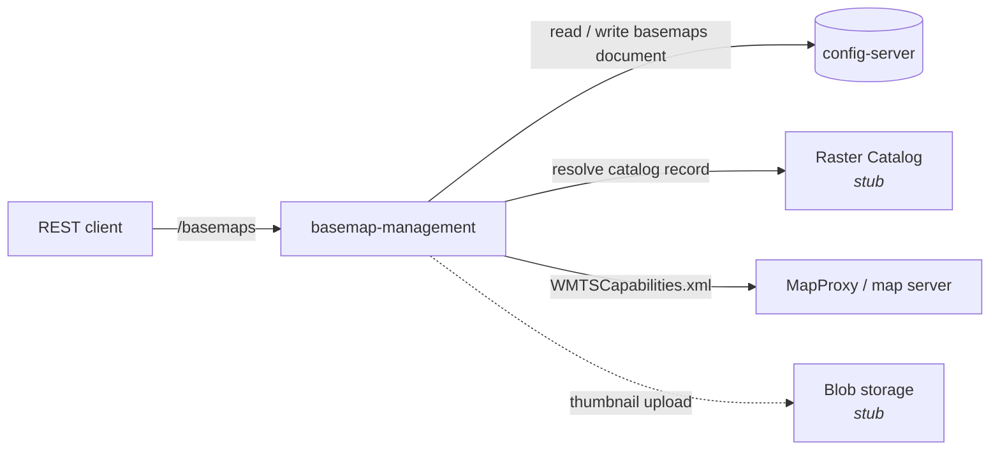

# basemap-management

REST service that manages **Basemaps** for the MapColonies ecosystem. A Basemap is a named, ordered composition of map layers, with a thumbnail and two "default role" flags (`isCurrent`, `isForPreview`). Clients such as the Main App consume it to decide which layers to render.

The service owns Basemap *configuration* only. It stores no tiles and no raster data.

- [Architecture](#architecture)
- [Getting started](#getting-started)
- [Configuration](#configuration)
- [API](#api)
- [Data models](#data-models)
- [Testing](#testing)
- [Build and deployment](#build-and-deployment)
- [Development notes](#development-notes)

## Architecture



Three concerns are kept separate:

1. **Configuration storage.** The whole Basemap list is one JSON document (`{ "basemaps": [...] }`) held in config-server under `CONFIG_BASEMAPS_NAME`. Catalog layers are stored only as *references* (`domain` + `uniqueness`), never as resolved data.
2. **Catalog resource resolution.** On every read, `CatalogResourceResolver` turns each stored catalog reference into a resolved one: it asks the Raster Catalog for the record, finds the record's `WMTS` link, and matches the link name against the layers in the map server's WMTS capabilities. If any step fails, the layer is returned as `UNRESOLVED_CATALOG_RESOURCE`. It is never dropped and never fails the request.
3. **External resources.** `EXTERNAL` layers are stored and returned as-is (`protocol`, `name`, `url`, plus any extra keys). They are not fetched or validated beyond those three fields.

| Integration | Client | Status |
| --- | --- | --- |
| config-server | `HttpConfigServerClient` | Implemented. `GET/POST {CONFIG_MANAGEMENT_URL}/api/config`. |
| Map server (Raster MapProxy) | `HttpMapServerCapabilitiesClient` | Implemented. Fetches `{MAP_SERVER_URL}/wmts/1.0.0/WMTSCapabilities.xml` once per request. |
| Raster Catalog | `StubRasterCatalogClient` | **Stub only.** Always returns "not found", so every catalog layer is `UNRESOLVED_CATALOG_RESOURCE`. `RASTER_CATALOG_MODE=http` is rejected at startup (no HTTP client exists). |
| Blob storage / data-service | `StubBlobStorageClient` | **Stub only.** Keeps thumbnails in process memory and returns `memory://` URLs. `DATA_SERVICE_URL` is read but unused. |

Source layout:

```
src/
  basemaps/
    controllers/   HTTP handlers (CRUD + thumbnail, import/export)
    routes/        Express router mounted at /basemaps
    models/        manager, catalog resolver, validation, default-role policy, types
    packaging/     export/import ZIP reader and writer
    thumbnails/    PNG/WebP header sniffing
  clients/         configServer, mapServer, rasterCatalog, blobStorage
  common/          config, env, errors, tracing, multipart helper
openapi3.yaml      API contract (also used for request validation)
config/            node-config defaults
helm/              Helm chart
tests/             unit and integration tests
```

## Getting started

### Prerequisites

- Node.js 24 (see [.nvmrc](.nvmrc))
- npm
- A reachable config-server. It is required for every `/basemaps` call, because all state lives there.
- Optional: a MapProxy URL, to get resolved catalog layers (see the stub note above).
- Optional: Docker and Helm, for container and cluster deployment.

### Install

```bash
npm install
```

`npm install` also runs the `prepare` script, which installs the Husky git hooks (commitlint, pre-commit).

### Run locally

`start:dev` builds the project, enables `@map-colonies/config` offline mode and source maps, and starts the server on port 8080:

```bash
CONFIG_MANAGEMENT_URL=http://localhost:8080 \
MAP_SERVER_URL=http://localhost:8081 \
npm run start:dev
```

Replace the URLs with your config-server and MapProxy. `CONFIG_MANAGEMENT_URL` defaults to `http://localhost:8080`, which is also this service's own port, so point it elsewhere or change `SERVER_PORT`.

Then open the Swagger UI at <http://localhost:8080/docs/api/> (raw spec: `/docs/api.json`).

`npm start` does the same without offline mode. It needs a real `@map-colonies/config` server (`CONFIG_SERVER_URL`, `CONFIG_NAME`, `CONFIG_VERSION`) for the boilerplate settings.

### Scripts

| Script | Purpose |
| --- | --- |
| `npm run start:dev` | Build and run in offline-config mode with source maps |
| `npm start` | Build and run |
| `npm run build` | Clean, regenerate OpenAPI types, compile to `dist/`, copy assets |
| `npm run generate:openapi-types` | Regenerate `src/openapi.d.ts` from `openapi3.yaml`. Run after any OpenAPI change. |
| `npm run lint` / `lint:fix` | ESLint (runs Prettier check/fix first) |
| `npm run format` / `format:fix` | Prettier check / write |
| `npm run lint:openapi` | Lint `openapi3.yaml` with Redocly |
| `npm test`, `test:unit`, `test:integration`, `test:watch`, `test:ui` | Vitest, see [Testing](#testing) |
| `npm run helm-update` / `helm-install` / `helm-uninstall` | Helm helpers, see [Build and deployment](#build-and-deployment) |

Commits follow Conventional Commits (enforced by commitlint). Releases are managed by release-please.

## Configuration

Settings come from two places.

### 1. Service settings (environment variables)

Read directly from `process.env` in [src/common/env.ts](src/common/env.ts). Invalid values fail startup.

| Variable | Default | Description |
| --- | --- | --- |
| `CONFIG_MANAGEMENT_URL` | `http://localhost:8080` | config-server **origin only**, without `/api/config` (the service appends it). |
| `CONFIG_BASEMAPS_NAME` | `basemaps` | `configName` of the Basemaps document in config-server. |
| `CONFIG_BASEMAPS_SCHEMA_ID` | `https://mapcolonies.com/basemaps/v1` | config-server `schemaId` for that document. Not yet registered in config-server's schemas. |
| `MAP_SERVER_URL` | `''` | Raster MapProxy base URL (maps to `mapServer.url` in the env object). `/wmts/1.0.0/WMTSCapabilities.xml` is appended unless already present. If empty or unreachable, catalog layers come back `UNRESOLVED_CATALOG_RESOURCE`. |
| `RASTER_CATALOG_MODE` | `stub` | `stub` or `http`. `http` is not implemented and aborts startup. |
| `RASTER_CATALOG_URL` | `''` | Placeholder, unused while mode is `stub`. |
| `DATA_SERVICE_URL` | `''` | Placeholder, unused. Thumbnails go to the in-memory stub. |
| `THUMBNAIL_MAX_SIZE_BYTES` | `2097152` (2 MiB) | Max thumbnail upload size. |
| `IMPORT_PACKAGE_MAX_SIZE_BYTES` | `10485760` (10 MiB) | Max import package upload size. |

The multipart parser limit is the larger of the two size limits. The import ZIP reader separately caps the archive at 10 entries and 10 MiB uncompressed.

### 2. Boilerplate settings (`@map-colonies/config`)

Validated against `commonBoilerplateV3` from `@map-colonies/schemas`. Defaults are in [config/default.json](config/default.json) (`config/production.json` and `config/test.json` are empty). Common environment overrides:

| Variable | Default | Description |
| --- | --- | --- |
| `SERVER_PORT` | `8080` | HTTP port. The Dockerfile also sets `8080`. |
| `LOG_LEVEL` | `info` | Log level. |
| `LOG_PRETTY_PRINT_ENABLED` | `false` | Pretty logs for local reading. |
| `OPENTELEMETRY_LOGGING_ENABLED` / `OTLP_LOGGER_ENDPOINT_URL` | `false` / unset | OpenTelemetry log export. |
| `TELEMETRY_TRACING_ENABLED` / `TELEMETRY_TRACING_URL` | `false` / unset | Tracing export. |
| `CONFIG_OFFLINE_MODE` | `false` | Use local `config/` files only (set by `start:dev`). |
| `CONFIG_SERVER_URL`, `CONFIG_NAME`, `CONFIG_VERSION` | n/a | Where the `@map-colonies/config` package fetches its own settings in online mode. Distinct from the Basemaps document above. |

Request body limit (`server.request.payload.limit`, `1mb`) and response compression are set in `config/default.json`. The Helm chart maps `env.requestPayloadLimit` and `env.responseCompressionEnabled` to `REQUEST_PAYLOAD_LIMIT` and `RESPONSE_COMPRESSION_ENABLED`.

> Note: `@map-colonies/config` and the service settings are intentionally separate. The shared boilerplate schema has no extension point for domain settings, so those are read straight from the environment.

## API

Full contract: [openapi3.yaml](openapi3.yaml), served at `/docs/api/`. All routes are mounted under `/basemaps`. There is no authentication or authorization in this service (`security: - {}`); protect it at the gateway or network level.

| Method | Path | Description | Success |
| --- | --- | --- | --- |
| `GET` | `/basemaps` | List all Basemaps (catalog layers resolved) | `200` |
| `POST` | `/basemaps` | Create a Basemap | `201` |
| `GET` | `/basemaps/{basemapId}` | Get one Basemap | `200` |
| `PUT` | `/basemaps/{basemapId}` | Fully replace a Basemap | `200` |
| `DELETE` | `/basemaps/{basemapId}` | Delete a Basemap | `204` |
| `POST` | `/basemaps/thumbnails` | Upload a 128x128 PNG/WebP (`multipart/form-data`, field `thumbnail`) | `201` |
| `GET` | `/basemaps/{basemapId}/export` | Download a portable ZIP (`basemap.json` + thumbnail) | `200` |
| `POST` | `/basemaps/import/validate` | Validate an export ZIP (`multipart/form-data`, field `package`). Persists nothing. | `200` |

Errors are JSON `{ "message": "..." }`: `400` validation, `404` unknown id, `502` config-server or thumbnail download failure (`UpstreamServiceError`). Request shape is validated by `express-openapi-validator` before any handler runs.

Liveness: `GET /liveness` (served at the root, outside `/basemaps`).

### Create flow

1. Upload the thumbnail (must be exactly 128x128, PNG or WebP, within the size limit; type is detected from the file bytes, not the MIME header):

   ```bash
   curl -F thumbnail=@thumb.png http://localhost:8080/basemaps/thumbnails
   # {"url":"memory://basemaps/thumbnails/<uuid>.png","width":128,"height":128}
   ```

2. Create the Basemap, passing the returned object as `thumbnail`:

   ```bash
   curl -X POST http://localhost:8080/basemaps \
     -H 'content-type: application/json' \
     -d '{
       "name": "Default",
       "thumbnail": { "url": "memory://basemaps/thumbnails/<uuid>.png", "width": 128, "height": 128 },
       "isCurrent": true,
       "isForPreview": false,
       "layers": [
         {
           "id": "orthophoto",
           "order": 0,
           "opacity": 1,
           "source": {
             "type": "CATALOG_RESOURCE",
             "domain": "RASTER",
             "uniqueness": { "productId": "MY_PRODUCT", "productType": "Orthophoto" }
           }
         },
         {
           "id": "osm",
           "order": 1,
           "opacity": 0.5,
           "source": {
             "type": "EXTERNAL",
             "details": { "protocol": "XYZ", "name": "osm", "url": "https://tile.example.com/{z}/{x}/{y}.png" }
           }
         }
       ]
     }'
   ```

### Write rules

- `name` non-empty; `thumbnail.url` non-empty; `opacity` between 0 and 1; `order` integer >= 0.
- Layer `id` and `order` must each be unique within a Basemap.
- Catalog layers need a non-empty `uniqueness.productId` and a known `productType` (`Orthophoto`, `OrthophotoHistory`, `OrthophotoBest`, `RasterMap`, `RasterMapBest`, `RasterAid`, `RasterAidBest`, `RasterVector`, `RasterVectorBest`).
- External layers need `protocol` (`XYZ`, `WMTS`, `WMS`, `OSM`), `name` and `url`.
- **Default roles:** at most one Basemap has `isCurrent=true` and at most one has `isForPreview=true`. Setting a flag to `true` on create or update clears it from the previous owner in the same write. The two flags are independent.
- `PUT` replaces the whole Basemap. `id` is server-assigned (a UUID on create); the body has no `id` field.
- Writes never accept `RESOLVED_CATALOG_RESOURCE` or `UNRESOLVED_CATALOG_RESOURCE`.

### Layer source types

Input (accepted by `POST`/`PUT`, and what is persisted/exported) and output (returned by every read and write response, and the import review) are different types.

| Type | Direction | Shape | Meaning |
| --- | --- | --- | --- |
| `CATALOG_RESOURCE` | input | `domain`, `uniqueness` | Reference to a catalog product. Environment independent. |
| `EXTERNAL` | input and output | `details` | Externally served layer, returned unchanged. |
| `RESOLVED_CATALOG_RESOURCE` | output | `domain`, `layer`, `capabilities` | Catalog record **and** its MapProxy WMTS capabilities were found. |
| `UNRESOLVED_CATALOG_RESOURCE` | output | `domain`, `uniqueness` | The reference could not be resolved (see below). Returned as the original reference. |

A catalog layer is resolved only when all of these hold:

1. The Raster Catalog returns a record for `uniqueness` (never true with the current stub).
2. The record has a `WMTS` link with a `name`.
3. The map server's WMTS capabilities contain a layer whose `ows:Identifier` equals that link name.

`capabilities` follows `CapabilityModelType`: `id`, `style[]`, `format[]`, `tileMatrixSet[]` (`tileMatrixSetID`, `tileMatrixLabels`), `url[]` (`format`, `resourceType`, `template`). Example resolved source (abridged):

```json
{
  "type": "RESOLVED_CATALOG_RESOURCE",
  "domain": "RASTER",
  "layer": { "id": "<record-id>", "productId": "MY_PRODUCT", "productType": "Orthophoto", "links": [{ "protocol": "WMTS", "name": "my-layer" }] },
  "capabilities": {
    "id": "my-layer",
    "format": ["image/png"],
    "tileMatrixSet": [{ "tileMatrixSetID": "WorldCRS84", "tileMatrixLabels": ["0", "1"] }],
    "url": [{ "format": "image/png", "resourceType": "tile", "template": "https://.../{TileMatrix}/{TileCol}/{TileRow}.png" }]
  }
}
```

### Export and import

`GET /basemaps/{id}/export` returns a ZIP with `basemap.json` (name, flags, thumbnail file name and size, layers as stored input) and the thumbnail binary. The service downloads the thumbnail from its stored URL, so export fails with `502` if that URL is not retrievable (this includes `memory://` URLs from the stub storage).

`POST /basemaps/import/validate` reads such a ZIP and returns a review: each layer resolved like a normal read with `status` `RESOLVED` or `UNRESOLVED`, the thumbnail as base64, and `currentRoleConflict` / `previewRoleConflict` naming the Basemap that currently owns a role the package wants. The review is a draft; to import, the client posts the Basemap through the normal create endpoint. A malformed ZIP, unsafe entry names, a missing or non-128x128 thumbnail, or invalid `basemap.json` return `400`.

## Data models

Types live in [src/basemaps/models/types.ts](src/basemaps/models/types.ts) and [catalogTypes.ts](src/basemaps/models/catalogTypes.ts).

```ts
interface IBasemap {                    // API output
  id: string; name: string;
  thumbnail: { url: string; width: 128; height: 128 };
  isCurrent: boolean; isForPreview: boolean;
  layers: IBasemapLayerOutput[];
}
interface IBasemapLayerBase {
  id: string; order: number; opacity: number;   // opacity 0..1
  shouldBeUsedInModelDraping?: boolean;
}
```

- **`domain`**: catalog domain of a catalog source. The API accepts only `RASTER` (the enum also lists `3D`, `DEM`, `VECTOR`, but they are not supported by the API schema or resolver).
- **`uniqueness`**: identity of a catalog product, `{ productId, productType }`. It is the only persisted identity of a catalog layer, so Basemaps stay portable across environments (no environment-specific record ids).
- **Source types**: see [Layer source types](#layer-source-types).

**Persisted vs. returned.** What is stored in config-server (`IPersistedBasemap`) is the input shape: catalog layers as `CATALOG_RESOURCE` references. Responses are built on every request by resolving those references (`IBasemap`). Resolved data is never written back, so catalog or MapProxy changes show up without touching stored Basemaps.

```jsonc
// config-server document for CONFIG_BASEMAPS_NAME
{ "basemaps": [ { "id": "<uuid>", "name": "...", "thumbnail": {...}, "isCurrent": true, "isForPreview": false, "layers": [ /* input-shaped layers */ ] } ] }
```

### Persistence and concurrency

Each write reads the latest document, applies the change, checks the role invariant, and POSTs the next version (`previous + 1`, or `1` for a new document). A `404` from config-server on read is treated as an empty list. Writes within one process are serialized by an in-memory queue. There is no cross-replica lock: concurrent writes from different replicas rely on config-server rejecting a stale version (a non-2xx reply becomes a `502`; this behaviour of config-server is not verified here). Treat the Helm default of one replica as the safe setting.

## Testing

Tests use [Vitest](https://vitest.dev/) with `supertest` and `jest-openapi` (responses are checked against `openapi3.yaml`). They need no external services: config-server, MapProxy, catalog and blob storage are replaced by test doubles.

```bash
npm test                  # unit + integration, with coverage (80% thresholds)
npm run test:unit         # tests/unit, no coverage
npm run test:integration  # tests/integration, no coverage
npm run test:watch        # watch mode
npm run test:ui           # Vitest UI
```

Coverage reports (text, html, json) are written to `coverage/`.

## Build and deployment

### Docker

Multi-stage [Dockerfile](Dockerfile): builds on `node:24`, runs on `node:24.10.0-alpine3.22` as the non-root `node` user with `dumb-init`, `NODE_ENV=production`, `SERVER_PORT=8080`.

```bash
docker build -t basemap-management .
docker run --rm -p 8080:8080 \
  -e CONFIG_MANAGEMENT_URL=http://config-server \
  -e MAP_SERVER_URL=http://mapproxy \
  -e CONFIG_OFFLINE_MODE=true \
  basemap-management
```

Drop `CONFIG_OFFLINE_MODE` when a `@map-colonies/config` server is available (`CONFIG_SERVER_URL`, etc.).

### Helm

Chart in [helm/](helm/) (depends on `helm-common` from the MapColonies OCI registry). Deployment settings are in [helm/values.yaml](helm/values.yaml) and [helm/global.yaml](helm/global.yaml).

```bash
npm run helm-update    # helm dependency update helm
npm run helm-install   # helm install with global.yaml + values.yaml
npm run helm-uninstall
```

| Value | Maps to | Notes |
| --- | --- | --- |
| `global.configManagment.url` | `CONFIG_MANAGEMENT_URL` | Origin only, no `/api/config`. The key is spelled `configManagment` in the chart. |
| `configManagement.{name,version,offlineMode,serverUrl}` | `CONFIG_NAME`, `CONFIG_VERSION`, `CONFIG_OFFLINE_MODE`, `CONFIG_SERVER_URL` | `@map-colonies/config` bootstrap. |
| `basemapManagement.configServer.{name,schemaId}` | `CONFIG_BASEMAPS_NAME`, `CONFIG_BASEMAPS_SCHEMA_ID` | Basemaps document. |
| `basemapManagement.mapServer.url` | `MAP_SERVER_URL` | Set it, or catalog layers stay unresolved. |
| `basemapManagement.rasterCatalog.{url,mode}` | `RASTER_CATALOG_URL`, `RASTER_CATALOG_MODE` | Keep `mode: stub`. |
| `basemapManagement.dataService.url` | `DATA_SERVICE_URL` | Placeholder. |
| `basemapManagement.uploadLimits.*` | `THUMBNAIL_MAX_SIZE_BYTES`, `IMPORT_PACKAGE_MAX_SIZE_BYTES` | |
| `env.*` | `REQUEST_PAYLOAD_LIMIT`, `RESPONSE_COMPRESSION_ENABLED` | Rendered only when `global.configManagment.enabled` is false. |
| `telemetry.logger.opentelemetryOptions` | `OPENTELEMETRY_LOGGING_ENABLED`, `OTLP_LOGGER_ENDPOINT_URL` | |

Chart defaults: 1 replica, container port 8080, service port 80, OpenShift route enabled, ingress disabled (`/basemap-management` path if enabled), liveness/readiness probes on, 100m CPU / 128Mi memory. The placeholder `<CONFIG_MANAGEMENT_URL>` in `global.yaml` must be replaced.

Deployment considerations:

- The service is stateless apart from the stub thumbnail store. With stub blob storage, thumbnails are lost on restart and not shared between replicas, so **it is not production-ready for thumbnail persistence** until a real blob/data-service client replaces `StubBlobStorageClient`.
- Run a single replica until write conflicts across replicas are handled (see [Persistence and concurrency](#persistence-and-concurrency)).
- CI ([.github/workflows](.github/workflows)) runs lint, OpenAPI lint, Helm lint, Snyk, tests, and a Docker build on pull requests; tagged releases (`v*`) push the image.

## Development notes

- Dependency injection via `tsyringe`; clients are bound to interface tokens in [src/containerConfig.ts](src/containerConfig.ts), which is the place to swap a stub for a real client.
- `src/openapi.d.ts` is generated. Edit `openapi3.yaml`, then run `npm run generate:openapi-types` (also done by `npm run build`).
- Domain errors extend `AppHttpError` ([src/common/errors.ts](src/common/errors.ts)) and are translated to HTTP responses by `@map-colonies/error-express-handler`. Logging uses `@map-colonies/js-logger`; metrics are collected by `@map-colonies/prometheus`; tracing is initialised in `src/instrumentation.mts` before the app starts.

Troubleshooting:

| Symptom | Likely cause |
| --- | --- |
| Startup error `RASTER_CATALOG_MODE=http is not implemented yet` | Use `RASTER_CATALOG_MODE=stub` (or unset). |
| `502` on every `/basemaps` call | config-server unreachable or returned an error. Check `CONFIG_MANAGEMENT_URL` (origin only). |
| All catalog layers are `UNRESOLVED_CATALOG_RESOURCE` | Expected with the stub catalog. Otherwise check `MAP_SERVER_URL` and the warnings in the logs. |
| Export returns `502` | The stored thumbnail URL cannot be fetched (e.g. a `memory://` URL). |
| `config not initialized` / config schema errors at startup | Run with `npm run start:dev`, or provide `CONFIG_SERVER_URL`, `CONFIG_NAME`, `CONFIG_VERSION`. |
